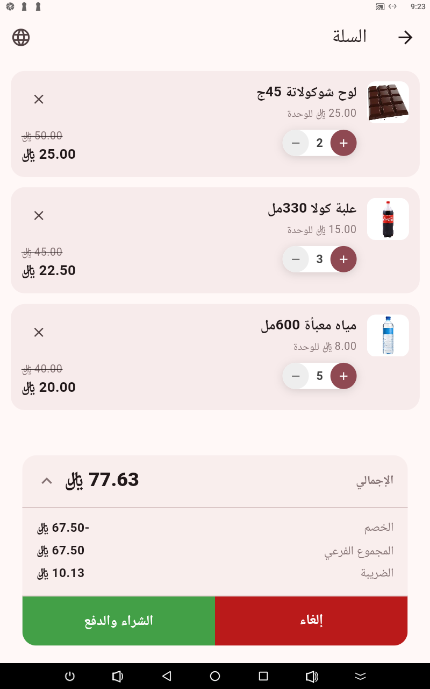
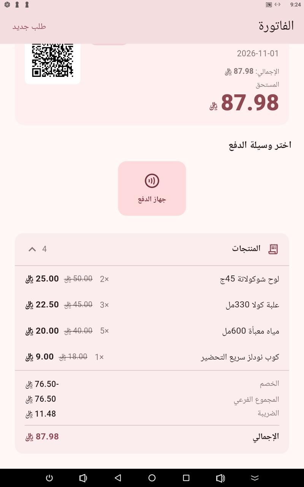
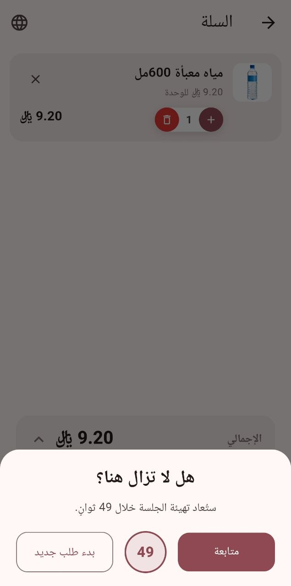

# Waha Kiosk — Flutter app

Self-service kiosk app for Waha. A customer scans or browses products, reviews the cart, and pays by card terminal or QR code. It talks to the [Waha backend](https://github.com/MohammadMousa/waha) REST API.

The Waha modules are separate repositories:

- **`waha_platform`** (this repo) — the self-service kiosk.
- **`waha_client`** — the normal / shopping app (web and phone).
- **`waha_admin`** — the dashboard and admin screens.

---

## Stack

- **Flutter / Dart** — Android kiosk (package `com.waha.kiosk`); Linux desktop builds exist for development
- **Provider** — state management
- `flutter_localizations` + ARB — full Arabic / English localisation, RTL-aware
- `shared_preferences` — device token, store and settings across restarts
- Drift (SQLite) — local catalog, local orders and the file cache list
- `webview_flutter` — HTML landing pages
- Kotlin (Android) — Geidea card terminal SDK over USB, log capture and upload, crash and USB diagnostics

## Documentation

| Document | Contents |
|---|---|
| [SETUP.md](SETUP.md) | Install, run, build and set up a device |
| [docs/architecture.md](docs/architecture.md) | Startup, sign-in, server connection, screens and settings |
| [docs/payments.md](docs/payments.md) | Card and QR payments, and late approval |
| [docs/offline-sync.md](docs/offline-sync.md) | Offline modes, local orders, sync and cached files |
| [docs/device-operations.md](docs/device-operations.md) | Logs, scan commands, restarts and troubleshooting |
| [docs/backend-integration.md](docs/backend-integration.md) | The backend APIs the kiosk uses |
| [docs/landing-page-rendering.md](docs/landing-page-rendering.md) | Landing page loading, links and debugging |

Update the matching document when you change behaviour. Keep each topic in one place.

---

## How it works

**One mode.** The app is always a kiosk. Every screen needs a **device sign-in** (device username and PIN).

**Customer flow.** Landing page, then scan or browse, cart, checkout, invoice and payment, and the paid screen with the invoice QR.

**Payment.** Card on a Geidea terminal over USB, or QR payment on the customer's phone.

**Offline.** The server decides the level: online only, caching, or full offline selling with a local database and sync.

**Admin commands (QR).** `cmd=upload-logs`, `cmd=sync-pull`, `cmd=build-info`, and `cmd=profile`.

---

## Project structure

```
lib/
├── config/        API base URL, connection settings, screen scale
├── data/          catalog/ (offline levels, local catalog), db/ (Drift), orders/ (local orders, push),
│                  resources/ (file cache), sync/ (pull)
├── l10n/          app_en.arb, app_ar.arb, generated/ (flutter gen-l10n output — do not edit)
├── models/        auth_session, cart_item, category, order, payment_method, pay_result,
│                  product, product_page, quote, store, terminal_session
├── router/        app_router.dart — named routes, device-login gate, allowlist
├── screens/       landing, scan, camera_scan, browse, categories, search, cart, checkout,
│                  invoice, qr_payment, success, settings, simulator_settings,
│                  kiosk_login, server_connection
├── services/      api_client, geidea_terminal_bridge, late_approval_service,
│                  auto_restart_service, heartbeat_service, landing_cache, local_prefs,
│                  connection_switcher, hardware_scanner_service, trace_log, usb_diagnostics, ...
├── state/         auth_service, order_flow_controller, store_config_service, locale_service,
│                  kiosk_timer_config, permission_service, simulator_service, startup_connection
├── utils/         scanner_manager (cmd= commands), scan_actions, money, locale_name
└── widgets/       kiosk_idle_guard, device_pin_dialog, profile_sheet, product_detail_sheet,
                   waha_app_bar, waha_bottom_nav, simulator_overlay, ...
android/app/src/main/kotlin/com/waha/kiosk/   terminal SDK glue, log upload, diagnostics
```

---

## Localization

ARB files live in `lib/l10n/`. After editing, regenerate:

```bash
flutter gen-l10n
```

Generated files go to `lib/l10n/generated/` — do not edit by hand. The active locale is managed by `LocaleService` and toggled with the language button in the app bar.

---

## Tests

```bash
flutter analyze
flutter test
```

---

## Screenshots

Kiosk screens (Arabic, RTL), with a 50% offer applied.

| Cart with offer | Invoice and payment method | Paid, invoice QR | Idle prompt |
|---|---|---|---|
|  |  |  |  |
