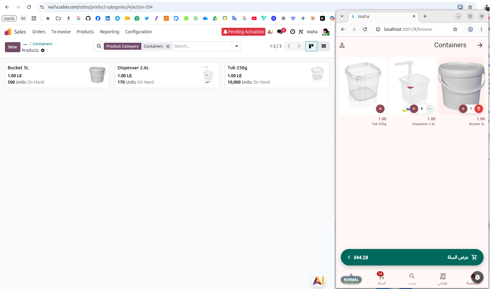
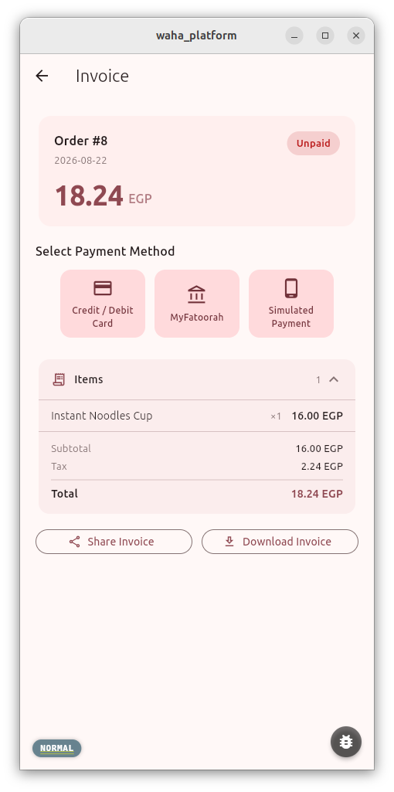
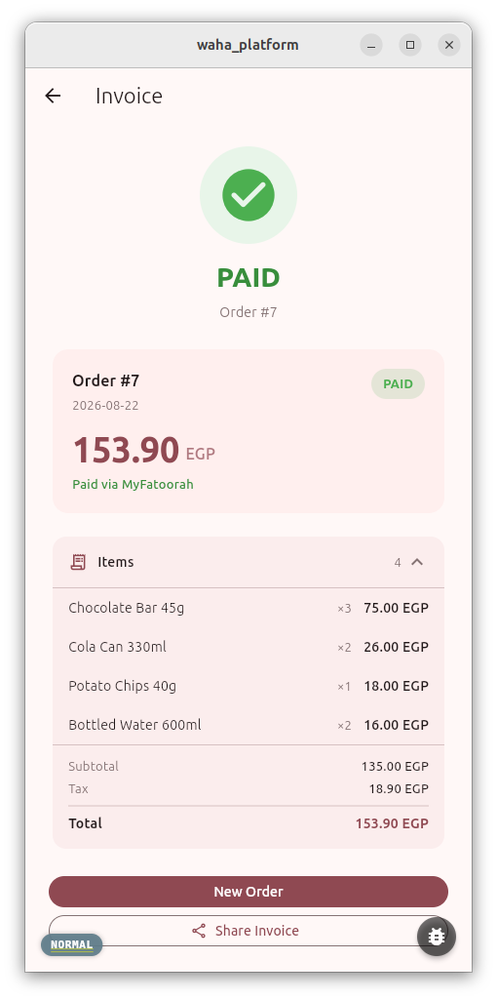

# Waha Kiosk — Flutter app

Self-service kiosk app for Waha. A customer scans or browses products, reviews the cart, and pays by card terminal or QR code. It talks to the [Waha backend](github.com/MohammadMousa/waha) REST API.

This repository is **kiosk-only**. The web and phone app (normal and shopping flows, admin screens) lives in `waha_client`, and the dashboard in `waha_admin`.

---

## Stack

- **Flutter / Dart** — Android kiosk (package `com.waha.kiosk`); Linux desktop builds exist for development
- **Provider** — state management
- `flutter_localizations` + ARB — full Arabic / English localisation, RTL-aware
- `shared_preferences` — device token, store and settings across restarts
- `webview_flutter` — HTML landing pages
- Kotlin (Android) — Geidea card terminal SDK over USB, log capture and upload, crash and USB diagnostics

## Running locally

```bash
# Android emulator
flutter run --dart-define=API_BASE_URL=http://10.0.2.2:8080

# Physical device or kiosk on the LAN
flutter run --dart-define=API_BASE_URL=http://192.168.1.x:8080

# Or use a settings file
flutter run --dart-define-from-file=config/dev.json
```

## Building for an environment

The server address is baked in at build time from a per-environment settings file in `config/` (git-ignored; only the `*.example.json` templates are committed).

```bash
cp config/prod.example.json config/prod.json   # then fill in the real values
scripts/build_release.sh prod                  # bumps the version, builds the APK
```

`API_BASE_URL` is the app's default server. A build without it falls back to the emulator address (`http://10.0.2.2:8081`), which a real device cannot reach — always build releases with the settings file or `--dart-define=API_BASE_URL=...`.

On the device, Settings → Developer Tools → Server Connection → **Custom Connection** overrides the default (ON), and returning to it (OFF) never loses the saved custom fields.

The app id is `com.waha.kiosk`. It installs as a new app next to any older install (`com.example.waha_platform`); saved login and settings are not carried over.

---

## How it works

**One mode.** The app is always a kiosk. Every screen sits behind the **device login** (device username + PIN, validated by the backend). A route outside the allowlist (landing, scan, cart, checkout, invoice, success, browse, categories, search, settings) bounces back to the landing page.

**Customer flow.** Landing page (HTML from the store's resource library) → scan products with the hardware scanner or camera, or browse → cart (server-computed quote, offers shown as struck-through prices and a Discount row) → checkout → invoice → pay → paid screen with the invoice QR, then back to the landing page.

**Payment.**
- **Card terminal** — Geidea terminal over USB. The kiosk hides Cancel once the terminal acknowledges the payment, shows "result unknown" when no answer arrives in time, and reports a late approval (after a cancel or timeout) to the server so the order can be settled.
- **QR payment** — the kiosk shows a QR, the customer pays on their phone, and the kiosk waits for the confirmation.

**Idle guard and restarts.** Configurable inactivity timers reset the kiosk to the landing page. A scheduled auto-restart runs only when the kiosk is idle on the landing page with an empty cart and no payment pending.

**Settings.** Reached by 10 taps on the cart screen followed by the device PIN. Developer Tools (10 taps on the version label) hold the server connection, screen scale, terminal tools and the simulator.

**Scan commands.** A QR or barcode with the `cmd=` prefix is a kiosk command, not a product:
- `cmd=upload-logs` — uploads the device log and shows the result.
- `cmd=profile` — asks for the device PIN, then opens the profile sheet where an admin can sign out or change the account.

**Logs.** The native log level comes from the server property `Log_Level` (Info, Warn or Error; default Warn). Warn and Error drop the per-byte SDK lines, receipts and card details and keep what an issue needs. `enable_logging` is the on/off switch. Old SDK log files are removed at app start.

**Server properties the kiosk reads:** `Log_Level`, `enable_logging`, `heartbeat_minutes`, `terminal_timeout_seconds`, and the auto-restart settings (`device_auto_restart_enabled`, `device_auto_restart_hours`, `device_auto_restart_wait_minutes`).

---

## Project structure

```
lib/
├── config/        API base URL, connection settings, screen scale
├── l10n/          app_en.arb, app_ar.arb, generated/ (flutter gen-l10n output — do not edit)
├── models/        auth_session, cart_item, category, order, payment_method, pay_result,
│                  product, product_page, quote, store, terminal_session
├── router/        app_router.dart — named routes, device-login gate, allowlist
├── screens/       landing, scan, camera_scan, browse, categories, search, cart, checkout,
│                  invoice, qr_payment, success, settings, simulator_settings,
│                  kiosk_login, server_connection
├── services/      api_client, geidea_terminal_bridge, late_approval_service,
│                  auto_restart_service, heartbeat_service, landing_cache, local_prefs,
│                  connection_switcher, hardware_scanner_service, trace_log, usb_diagnostics, ...
├── state/         auth_service, order_flow_controller, store_config_service, locale_service,
│                  kiosk_timer_config, permission_service, simulator_service, startup_connection
├── utils/         scanner_manager (cmd= commands), scan_actions, money, locale_name
└── widgets/       kiosk_idle_guard, device_pin_dialog, profile_sheet, product_detail_sheet,
                   waha_app_bar, waha_bottom_nav, simulator_overlay, ...
android/app/src/main/kotlin/com/waha/kiosk/   terminal SDK glue, log upload, diagnostics
```

---

## Localization

ARB files live in `lib/l10n/`. After editing, regenerate:

```bash
flutter gen-l10n
```

Generated files go to `lib/l10n/generated/` — do not edit by hand. The active locale is managed by `LocaleService` and toggled with the language button in the app bar.

---

## Tests

```bash
flutter analyze
flutter test
```

---

## Landing pages

See `docs/landing-page-rendering.md`. Pages are HTML from the store's resource library, shown in a WebView; root-relative paths are resolved at load time. Banner links such as `href="/screen?name=browse_screen&tag=TAG"` are intercepted and open the matching screen inside the app.

---

## Screenshots

| Browse with quantity stepper | Invoice (unpaid) | Invoice (paid) |
|---|---|---|
|  |  |  |
